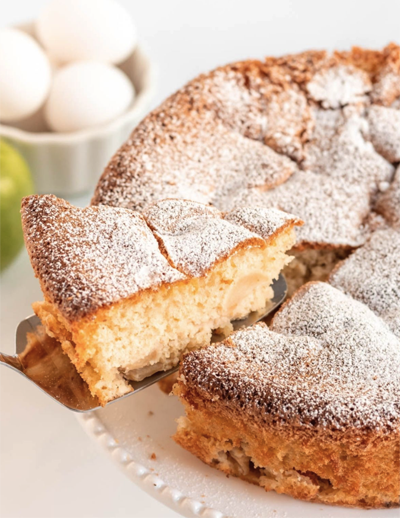

   

# ITSC_2530_Programming_Assignments-2026

## Vlad Horobchenko

When I’m away from the keyboard, you might find me in the kitchen. My unique hobby is baking apple pies—I love exploring the endless variety of recipes, regional styles, and flavor profiles out there.

For this course, I plan to reflect that passion into a C++ console application. My program will consolidate everything an enthusiast needs to know about apple pies, from ingredient ratios and dough-mixing techniques to precise baking parameters. I'm looking forward to building a project that brings a bit of culinary creativity into the world of C++!

   
  <em>Image: <a href="https://richanddelish.com/apple-cake-sharlotka/" target="_blank" rel="noopener noreferrer">Rich and Delish</a></em>

